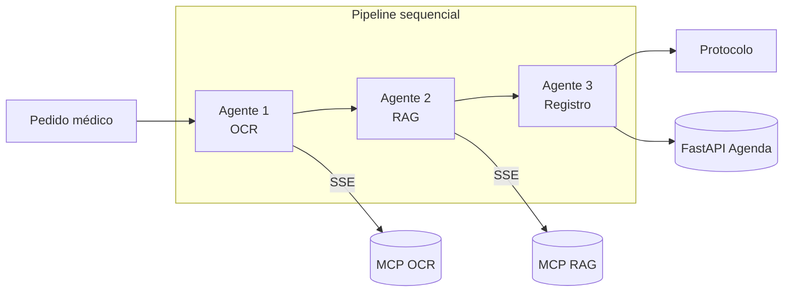
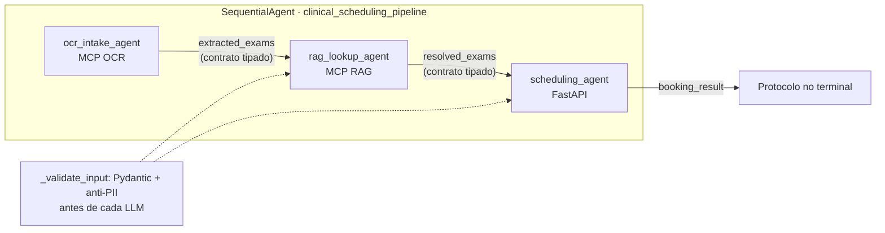
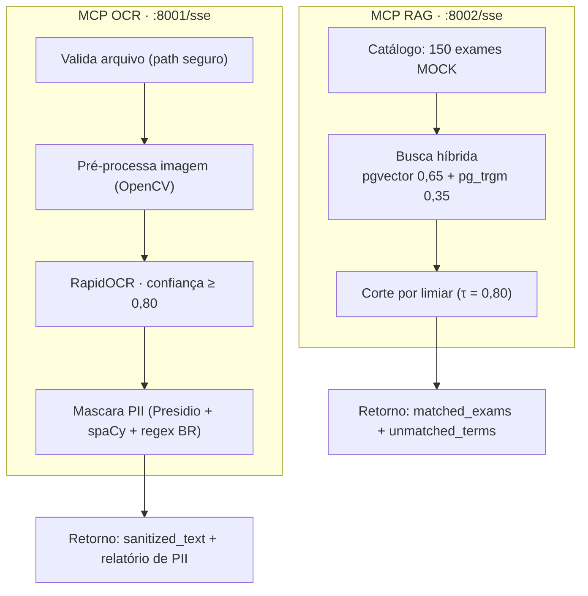
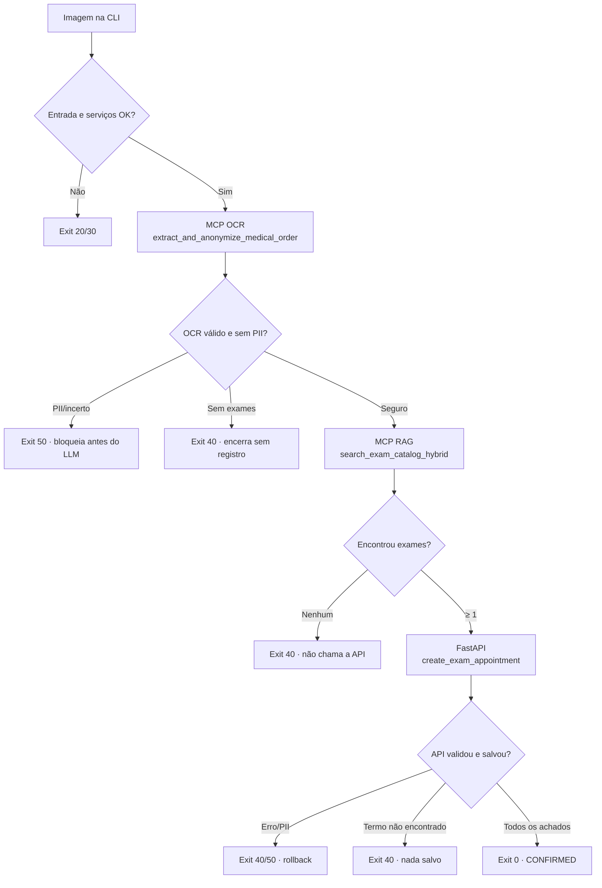

# Transpilador Google ADK

Implementação do [desafio técnico](docs/DESAFIO_SENIOR_IA.pdf): um **transpilador** que recebe uma especificação JSON, valida e gera código Python executável no **Google ADK**. O agente gerado é o assistente de CLI de agendamento de exames definido no desafio. Contratos e decisões detalhados na [especificação técnica](docs/especificacao-tecnica-e-arquitetura.md).

> **Escopo.** O pipeline aceita pedidos **digitados, nítidos e bem enquadrados** (não processa manuscritos). O registro na API só acontece quando **todos** os termos extraídos são encontrados no catálogo; termo sem correspondência bloqueia o pedido. Todos os dados do projeto são sintéticos, conforme o desafio exige (catálogo de 150 exames `MOCK-*`).

## Visão geral



Em **tempo de build**, o transpilador valida a [especificação JSON](specs/clinical_agent_spec.json) com Pydantic e gera o agente ([`runtime/generated/clinical_exam_scheduler_agent.py`](runtime/generated/clinical_exam_scheduler_agent.py)) — código versionável, coberto por teste anti-drift (recompilar a spec deve reproduzir o arquivo byte a byte). Em **tempo de execução**, esse agente roda como CLI: recebe a imagem do pedido e percorre **OCR → busca no catálogo → registro** até exibir o protocolo no terminal.

O agente conecta-se aos servidores MCP **exclusivamente via SSE** (`MCPToolset` + `SseConnectionParams`: `http://mcp-ocr:8001/sse` e `http://mcp-rag:8002/sse`), conforme emitido pelo transpilador. A CLI sinaliza falhas por código de saída: **10** spec · **20** imagem · **30** infra · **40** pipeline · **50** privacidade.

**Contratos estritos de dados.** Cada agente declara uma estrutura para **enviar** (`output_schema`) e outra para **receber** (`input_schema`, validada antes do LLM rodar). O objetivo é confiabilidade: a estrutura do dado que chega é garantida por contrato validado, não pela confiança no texto do modelo — e a comunicação entre etapas fica padronizada. Os callbacks gerados ainda exigem evidência real de execução de cada ferramenta (OCR, RAG, API) antes de avançar, e o mascaramento de PII acontece dentro do MCP de OCR, antes de qualquer texto chegar a um LLM (fail-closed).

<details>
<summary><strong>Anatomia dos agentes ADK</strong></summary>



Cada agente declara `output_schema` (o que envia) e `input_schema` (o que recebe, validado antes do LLM rodar); os callbacks gerados exigem evidência real de execução de cada ferramenta antes de avançar.

</details>

<details>
<summary><strong>Anatomia dos MCPs</strong></summary>



Dois servidores FastMCP independentes, conectados exclusivamente via SSE; o mascaramento de PII acontece dentro do MCP de OCR, antes de qualquer texto chegar a um LLM (fail-closed).

</details>

<details>
<summary><strong>Fluxo de decisão da imagem</strong></summary>



</details>

## Decisões de arquitetura

1. **PostgreSQL + pgvector em container** — o desafio permitia base simulada; optamos por um banco real porque o RAG exige busca vetorial. Centralizar base vetorial e relacional no **mesmo** PostgreSQL simplifica a operação de uma aplicação de CLI: um único serviço de dados, tudo no mesmo lugar. O catálogo sintético (150 exames) usa busca híbrida (vetorial com E5-small quantizado + trigram).
2. **Cadeia linear de três agentes** (`SequentialAgent`) — cada agente tem exatamente uma integração: os dois primeiros acessam os MCPs (OCR e RAG, via SSE) e o terceiro fala direto com a API de agendamento (FastAPI, via contrato OpenAPI). Fluxo determinístico, fácil de auditar etapa a etapa.
3. **Guardrails e contratos tipados** — schemas Pydantic gerados validam cada entrada e saída; PII é detectada e mascarada no MCP de OCR (regex BR + Presidio/spaCy + léxico do catálogo) antes de qualquer LLM ou persistência; resultados parciais do RAG não são enviados à API.

Componentes: `transpiler/` (DSL, templates e compilador) · `runtime/` (CLI e código gerado) · `services/` (MCPs de OCR/RAG e API de agendamento) · `security/` (callbacks de guardrail) · `specs/` (especificação JSON) · `docs/transpile-exemple/` (exemplos testados).

## Base de dados e RAG

**Uma única base relacional para tudo.** Em vez de um banco vetorial dedicado, o projeto usa **PostgreSQL + pgvector**: a mesma instância que a API de agendamento usa como base SQL (pedidos, protocolos, itens) também guarda os **vetores do catálogo de exames**. Para uma aplicação de CLI, isso significa um único serviço de dados para subir, fazer backup e healthcheck — a consulta do agente mistura dados vetoriais e relacionais no mesmo lugar, sem sincronização entre bancos.

**Vetorização e busca híbrida.** O catálogo (150 exames fictícios `MOCK-*`) é vetorizado com o modelo **E5-small multilíngue** (quantizado, ONNX, roda na CPU do container — sem GPU e sem API externa de embeddings). Na consulta, o RAG combina **similaridade vetorial** (pgvector, 65% — entende que "Hormonio Tireoestimulante" sem acento é o mesmo exame) com **similaridade de trigramas** (pg_trgm, 35% — robusta a erros de grafia do OCR), e só aceita correspondências acima de um limiar de confiança; o que fica abaixo vai para `unmatched_terms` e bloqueia o pedido (fail-closed).

**Seed automático.** Não há preparação manual de dados: ao subir, o container do RAG executa um **seed idempotente** que cria a tabela, gera os embeddings e insere os 150 exames com códigos, categoria, preparo e sinônimos. Subir o ambiente já entrega o RAG pronto para uso — sem gerar embeddings à mão e sem cadastrar exames.

## Setup

Duas formas de preparar o ambiente, ambas pelo Makefile:

| Comando            | Para quê                                                    | O que faz                                                                                               |
| ------------------ | ----------------------------------------------------------- | ------------------------------------------------------------------------------------------------------- |
| `make setup`       | Uso completo em **Docker** (aplicação inteira, CLI inclusa) | Constrói as imagens (`build`), sobe os containers (`up`) e executa o preflight                          |
| `make setup-local` | Trabalhar com o **transpilador localmente**                 | Cria `.venv` via uv (Python 3.12) e instala `.[dev]`; permite transpilar arquivos do próprio computador |

O `make setup` exige copiar `.env.example` para `.env` com `POSTGRES_PASSWORD` e `GEMINI_API_KEY`. A chave é usada **somente no `run` real**; não a imprima, não a coloque em código ou commits — `.env` é ignorado pelo Git e excluído do contexto Docker. Os modelos locais (spaCy `pt_core_news_sm` + Presidio no OCR/API; E5-small ONNX no RAG) são baixados durante o build das imagens.

## Transpilação

### Pipeline interno e escolhas de bibliotecas

O transpilador é um pipeline de 4 etapas, todas em build-time (`transpiler/compiler.py`):

1. **Validação (Pydantic v2)** — o JSON é validado de uma só vez contra o metamodelo da DSL (`transpiler/schema.py`), com validadores que checam referências cruzadas antes de gerar código: IDs únicos, schemas referenciados existentes, identificadores válidos de Python, MCP apenas via SSE com URL http(s). Se o JSON é inválido, o processo falha imediatamente com erro apontando o campo exato — nada é gerado.
2. **Geração (Jinja2)** — um template único (`adk_sequential_agent.py.j2`) renderiza o código final: classes Pydantic, agentes `LlmAgent`, o orquestrador `SequentialAgent`, bindings de MCP/OpenAPI e os callbacks de guardrail. `StrictUndefined` garante que variável faltando quebra o build em vez de gerar código incompleto, e o filtro `pyrepr` (baseado em `repr()`) converte strings do JSON em literais Python seguros, eliminando risco de injeção via aspas.
3. **Verificação (`ast.parse` + Ruff)** — o código renderizado é validado sintaticamente com `ast.parse` (sem executá-lo), formatado com `ruff format` e reanalisado, além de uma checagem via AST de que os imports obrigatórios do Google ADK estão presentes.
4. **Escrita** — o resultado vai para `runtime/generated/`, versionado no repositório.

| Lib                | Por quê                                                                                                                                                                               |
| ------------------ | ------------------------------------------------------------------------------------------------------------------------------------------------------------------------------------- |
| **Pydantic v2**    | Validação declarativa e falha rápida com mensagens precisas; os validadores de referência cruzada garantem que só JSON consistente chega à geração.                                   |
| **Jinja2**         | Template de código é legível e mantível — ler o `.j2` é praticamente ler o arquivo final. Gerar AST na mão seria muito mais código para o mesmo resultado.                            |
| **`ast` (stdlib)** | Valida a sintaxe do código gerado sem executá-lo — nenhum código gerado roda durante o build.                                                                                         |
| **Ruff**           | Formatação determinística: recompilar a mesma spec produz arquivo byte a byte idêntico, o que viabiliza o teste anti-drift (se o código versionado divergir da spec, o teste quebra). |
| **Google ADK**     | Requisito do desafio: os agentes são instanciados exclusivamente com `LlmAgent`/`SequentialAgent`/`MCPToolset`/`OpenAPIToolset`.                                                      |

A decisão central do design: **gerar código versionável em vez de interpretar o JSON em runtime**. Código gerado pode ser revisado, testado e auditado como qualquer código escrito à mão — e o pipeline inteiro garante que ele só existe se passou por validação de schema, verificação sintática e formatação canônica.

O mesmo compilador, duas rotas:

**Local — a mais fácil, recomendada para desenvolvimento:**

```bash
make transpile-local SPEC=docs/transpile-exemple/valido_01_agente_simples.json OUTPUT=docs/transpile-exemple/gerados/valido_01_agente_simples.py
```

Transpila qualquer JSON da sua máquina pelas variáveis `SPEC` (entrada) e `OUTPUT` (saída). Os exemplos prontos estão em [`docs/transpile-exemple/`](docs/transpile-exemple/): **4 especificações válidas** (agente simples, cadeia linear tipada, orquestrador de 4 etapas MCP/OpenAPI, agente multiferramenta) com os **códigos gerados em [`gerados/`](docs/transpile-exemple/gerados/)** comprovando o funcionamento, e **12 inválidas** que exercitam cada mensagem de erro da DSL — todas rejeitadas com exit 10, sem gravar saída.

**Docker — a rota oficial da entrega:**

```bash
make transpile
```

Transpila o JSON do projeto (`specs/clinical_agent_spec.json`) direto para o caminho que o container consome (`runtime/generated/...`). Não usa o fluxo local: executa dentro do container `agent-cli` com `--no-deps` (codegen puro, sem subir os outros serviços).

> Ao rodar via `make`, um erro de especificação aparece como "Erro 2" do make; o **exit code real da CLI é 10**, com a mensagem do validador.

## Containers e execução

```bash
make up        # sobe postgres-db, mcp-ocr (SSE :8001), mcp-rag (SSE :8002), scheduling-api (:8000)
make preflight # verifica saúde dos serviços antes de executar
make run       # executa o agente com a imagem de exemplo (usa o Gemini; pode ter custo)
make run-image IMAGE=/caminho/no/seu/computador/pedido.png   # executa com uma imagem sua
make logs      # logs dos containers (tail -f)
make stop | make down
```

- `make run` usa a imagem principal [`assets/carlos__good.png`](assets/carlos__good.png) (exames digitados e enumerados).
- `make run-image` copia qualquer imagem da sua máquina para o volume do container e executa o mesmo fluxo.
- Variantes de teste em `assets/`: legíveis (`ana__good`, `juliana__good`, `marina__good`, `rafael__good`), sombreada (`carlos__shadow.jpg`), cortada (`marina__cropped.jpg`) e ilegível (`pedro__bad.jpg`).

## Testes

```bash
make test   # suíte mock-only: não exige chave, rede, banco, OCR ou pesos
```

Cobre o transpilador (schema, AST, CLI), os serviços com fakes/mocks e o **drift-guard**, que recompila a spec e compara byte a byte com o artefato commitado — qualquer edição manual no código gerado quebra o teste. O e2e da suíte é **simulado** (não prova o fluxo real); a prova real está nas evidências abaixo. Verificação alternativa em imagem: `docker compose build agent-cli` + `docker run --rm desafio-carrefour-verity-agent-cli python -m pytest -q`.

## Evidências de funcionamento

O desafio pede evidências de funcionamento (logs da execução, capturas de tela da CLI, URL e interface do Swagger). Os artefatos estão em [`docs/evidences/`](docs/evidences/), coletados em **15/11/2026** com o ambiente Docker do projeto. Cada log começa com o **comando exato** executado (`make`), a data/hora e o exit code — tudo reproduzível seguindo o [Setup](#setup).

| Arquivo                                                                                                                           | Demonstração                                                                                                                                                                                                                                              |
| --------------------------------------------------------------------------------------------------------------------------------- | --------------------------------------------------------------------------------------------------------------------------------------------------------------------------------------------------------------------------------------------------------- |
| [`01-servicos-up.log`](docs/evidences/01-servicos-up.log)                                                                         | `docker compose ps`: os 4 serviços (Postgres, MCP OCR, MCP RAG, API) no ar e **healthy**, com healthchecks individuais.                                                                                                                                   |
| [`02-transpile-docker.log`](docs/evidences/02-transpile-docker.log)                                                               | `make transpile` (rota oficial): gera o agente ADK a partir do JSON, exit 0 e **drift zero** (regeneração byte a byte idêntica ao versionado).                                                                                                            |
| [`03-transpile-local-fluxos.log`](docs/evidences/03-transpile-local-fluxos.log)                                                   | `make transpile-local` com os **4 fluxos válidos** de exemplo (agente simples, cadeia linear, orquestrador misto, multiferramenta), todos exit 0 — mostra os outros fluxos que a DSL exporta e como gerá-los localmente.                                  |
| [`04-transpile-erros-excecoes.log`](docs/evidences/04-transpile-erros-excecoes.log)                                               | Robustez do validador: JSON malformado, transporte MCP não-SSE e referência cruzada inexistente — exceções na prática com mensagem clara apontando o campo, **exit 10** e **nenhuma saída gravada**.                                                      |
| [`05-swagger.png`](docs/evidences/05-swagger.png) · [`05-openapi.json`](docs/evidences/05-openapi.json)                           | Interface do **Swagger** em <http://localhost:8000/docs> (OAS 3.1, 3 endpoints documentados) e o contrato OpenAPI servido pela API.                                                                                                                       |
| [`06-run-cli-valida.log`](docs/evidences/06-run-cli-valida.log) · [`06-protocolo-get.json`](docs/evidences/06-protocolo-get.json) | `make run-image IMAGE=.../assets/carlos__good.png`: execução real com Gemini, fluxo completo **OCR → RAG → registro** (exit 0), protocolo `LAB-2026-11-15-XYEEZSBPGJ` **CONFIRMED** com 5 exames `MOCK-*`; o **GET** na API confirma o registro integral. |
| [`06-cli-screenshot.png`](docs/evidences/06-cli-screenshot.png)                                                                   | **Captura de tela da CLI** no terminal (`make run-image` com `assets/ana__good.png`): fluxo completo com Gemini em 23 s, protocolo CONFIRMED e os exames com códigos `MOCK-*` exibidos ao usuário.                                                        |
| [`07-run-cli-invalida.log`](docs/evidences/07-run-cli-invalida.log)                                                               | `make run-image` com imagem corrompida: bloqueio fail-closed com mensagem clara ("Imagem vazia ou com cabeçalho inválido") e **exit 20**, sem chegar a chamar LLM ou API.                                                                                 |
| [`08-testes.log`](docs/evidences/08-testes.log)                                                                                   | `make test`: suíte completa — **120 testes passando**, cobertura de **89%** nos módulos de transpilador/runtime/guardrails/serviços, e `ruff check` do código-fonte com 0 erros.                                                                          |

## Transparência e uso de IA

**Abordagem de desenvolvimento.** A IA foi utilizada em **todos os pontos** do desenvolvimento. Inicialmente, como auxiliar de **tomada de decisão de arquitetura** — trabalhando o fluxo de dados e o desenho da cadeia de agentes — e para **pesquisa de ferramentas e bibliotecas**. A técnica empregada foi a **engenharia de loop**: definidos o contexto e o objetivo de uma parte, executava-se um ciclo de **desenvolvimento → testes → revisão → correção**. Cada componente (transpilador, pipeline de agentes, MCPs, API e contrato de dados) passou por múltiplas rodadas desse ciclo, e **após cada rodada houve revisão humana** para validar a qualidade do código produzido pela IA. A ferramenta de codificação foi o **pi**, com modelos da OpenAI e GLM.

**Referências consultadas.** Documentação oficial do **Google ADK**; documentação do **FastAPI** e do **FastMCP**, utilizados para criar os servidores MCP deste projeto; documentação do protocolo MCP (transporte SSE).

**Estratégia de orquestração.** **Fluxo sequencial linear** (`SequentialAgent`) com três agentes, sem delegação a subagentes nem processamento paralelo. A escolha é deliberada: cada etapa consome a saída tipada da anterior, o caminho dos dados é determinístico e uma falha é atribuível à etapa exata em que ocorreu — propriedades desejáveis num pipeline com guardrails fail-closed.
