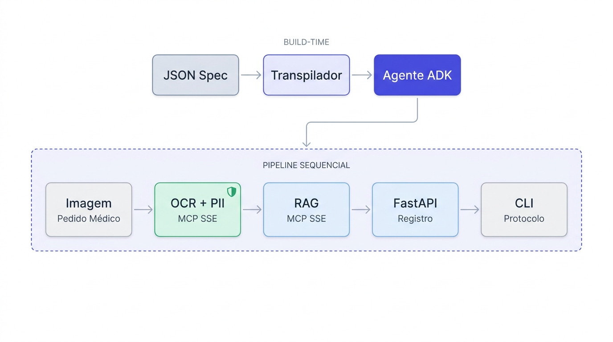

# Transpilador Google ADK

Implementação do [desafio técnico](docs/DESAFIO_SENIOR_IA.pdf): um **transpilador** que recebe uma especificação JSON, valida e gera código Python executável no **Google ADK**. O agente gerado é o assistente de CLI de agendamento de exames definido no desafio. Contratos e decisões detalhados na [especificação técnica](docs/especificacao-tecnica-e-arquitetura.md).

> **Escopo.** O pipeline aceita pedidos **digitados, nítidos e bem enquadrados** (não processa manuscritos). O registro na API só acontece quando **todos** os termos extraídos são encontrados no catálogo; termo sem correspondência bloqueia o pedido. Todos os dados do projeto são sintéticos, conforme o desafio exige (catálogo de 150 exames `MOCK-*`).

## Visão geral



Em **tempo de build**, o transpilador valida a [especificação JSON](specs/clinical_agent_spec.json) com Pydantic e gera o agente ([`runtime/generated/clinical_exam_scheduler_agent.py`](runtime/generated/clinical_exam_scheduler_agent.py)) — código versionável, coberto por teste anti-drift (recompilar a spec deve reproduzir o arquivo byte a byte). Em **tempo de execução**, esse agente roda como CLI: recebe a imagem do pedido e percorre **OCR → busca no catálogo → registro** até exibir o protocolo no terminal.

O agente conecta-se aos servidores MCP **exclusivamente via SSE** (`MCPToolset` + `SseConnectionParams`: `http://mcp-ocr:8001/sse` e `http://mcp-rag:8002/sse`), conforme emitido pelo transpilador. A CLI sinaliza falhas por código de saída: **10** spec · **20** imagem · **30** infra · **40** pipeline · **50** privacidade.

**Contratos estritos de dados.** Cada agente declara uma estrutura para **enviar** (`output_schema`) e outra para **receber** (`input_schema`, validada antes do LLM rodar). O objetivo é confiabilidade: a estrutura do dado que chega é garantida por contrato validado, não pela confiança no texto do modelo — e a comunicação entre etapas fica padronizada. Os callbacks gerados ainda exigem evidência real de execução de cada ferramenta (OCR, RAG, API) antes de avançar, e o mascaramento de PII acontece dentro do MCP de OCR, antes de qualquer texto chegar a um LLM (fail-closed).

Material técnico complementar (denso, leitura opcional): [anatomia dos agentes ADK](docs/agents_pipeline_diagram_v2_fixed_1794591427444.jpg) · [anatomia dos MCPs](docs/mcps_anatomy_diagram_1794579294803.jpg) · [fluxograma de decisão da imagem](docs/image_decision_flowchart_1794571572220.jpg).

## Decisões de arquitetura

1. **PostgreSQL + pgvector em container** — o desafio permitia base simulada; optamos por um banco real porque o RAG exige busca vetorial. Centralizar base vetorial e relacional no **mesmo** PostgreSQL simplifica a operação de uma aplicação de CLI: um único serviço de dados, tudo no mesmo lugar. O catálogo sintético (150 exames) usa busca híbrida (vetorial com E5-small quantizado + trigram).
2. **Cadeia linear de três agentes** (`SequentialAgent`) — cada agente tem exatamente uma integração: os dois primeiros acessam os MCPs (OCR e RAG, via SSE) e o terceiro fala direto com a API de agendamento (FastAPI, via contrato OpenAPI). Fluxo determinístico, fácil de auditar etapa a etapa.
3. **Guardrails e contratos tipados** — schemas Pydantic gerados validam cada entrada e saída; PII é detectada e mascarada no MCP de OCR (regex BR + Presidio/spaCy + léxico do catálogo) antes de qualquer LLM ou persistência; resultados parciais do RAG não são enviados à API.

Componentes: `transpiler/` (DSL, templates e compilador) · `runtime/` (CLI e código gerado) · `services/` (MCPs de OCR/RAG e API de agendamento) · `security/` (callbacks de guardrail) · `specs/` (especificação JSON) · `docs/transpile-exemple/` (exemplos testados).

## Setup

Duas formas de preparar o ambiente, ambas pelo Makefile:

| Comando | Para quê | O que faz |
|---|---|---|
| `make setup` | Uso completo em **Docker** (aplicação inteira, CLI inclusa) | Constrói as imagens (`build`), sobe os containers (`up`) e executa o preflight |
| `make setup-local` | Trabalhar com o **transpilador localmente** | Cria `.venv` via uv (Python 3.12) e instala `.[dev]`; permite transpilar arquivos do próprio computador |

O `make setup` exige copiar `.env.example` para `.env` com `POSTGRES_PASSWORD` e `GEMINI_API_KEY`. A chave é usada **somente no `run` real**; não a imprima, não a coloque em código ou commits — `.env` é ignorado pelo Git e excluído do contexto Docker. Os modelos locais (spaCy `pt_core_news_sm` + Presidio no OCR/API; E5-small ONNX no RAG) são baixados durante o build das imagens.

## Transpilação

O mesmo compilador, duas rotas:

**Local — a mais fácil, recomendada para desenvolvimento:**

```bash
make transpile-local SPEC=docs/transpile-exemple/valido_01_agente_simples.json OUTPUT=docs/transpile-exemple/gerados/valido_01_agente_simples.py
```

Transpila qualquer JSON da sua máquina pelas variáveis `SPEC` (entrada) e `OUTPUT` (saída). Os exemplos prontos estão em [`docs/transpile-exemple/`](docs/transpile-exemple/): **4 especificações válidas** (agente simples, cadeia linear tipada, orquestrador de 4 etapas MCP/OpenAPI, agente multiferramenta) com os **códigos gerados em [`gerados/`](docs/transpile-exemple/gerados/)** comprovando o funcionamento, e **12 inválidas** que exercitam cada mensagem de erro da DSL — todas rejeitadas com exit 10, sem gravar saída.

**Docker — a rota oficial da entrega:**

```bash
make transpile
```

Transpila o JSON do projeto (`specs/clinical_agent_spec.json`) direto para o caminho que o container consome (`runtime/generated/...`). Não usa o fluxo local: executa dentro do container `agent-cli` com `--no-deps` (codegen puro, sem subir os outros serviços).

> Ao rodar via `make`, um erro de especificação aparece como "Erro 2" do make; o **exit code real da CLI é 10**, com a mensagem do validador.

## Containers e execução

```bash
make up        # sobe postgres-db, mcp-ocr (SSE :8001), mcp-rag (SSE :8002), scheduling-api (:8000)
make preflight # verifica saúde dos serviços antes de executar
make run       # executa o agente com a imagem de exemplo (usa o Gemini; pode ter custo)
make run-image IMAGE=/caminho/no/seu/computador/pedido.png   # executa com uma imagem sua
make logs      # logs dos containers (tail -f)
make stop | make down
```

- `make run` usa a imagem principal [`assets/pedido_medico_teste.png`](assets/pedido_medico_teste.png) (exames digitados e enumerados).
- `make run-image` copia qualquer imagem da sua máquina para o volume do container e executa o mesmo fluxo.
- Variantes de teste (legíveis, sombreadas, cortadas, ilegíveis) estão em `assets/fixtures/`; a bateria histórica com 31 imagens está documentada em [`docs/relatorio-teste-e2e-fixtures.md`](docs/relatorio-teste-e2e-fixtures.md).

## Testes

```bash
make test   # suíte mock-only: não exige chave, rede, banco, OCR ou pesos
```

Cobre o transpilador (schema, AST, CLI), os serviços com fakes/mocks e o **drift-guard**, que recompila a spec e compara byte a byte com o artefato commitado — qualquer edição manual no código gerado quebra o teste. O e2e da suíte é **simulado** (não prova o fluxo real); a prova real está nas evidências abaixo. Verificação alternativa em imagem: `docker compose build agent-cli` + `docker run --rm desafio-carrefour-verity-agent-cli python -m pytest -q`.

## Evidências da entrega

[`evidence/`](evidence/) contém os artefatos de **13/11/2026**:

| Arquivo | Demonstração |
|---|---|
| [`01-compose-ps.txt`](evidence/01-compose-ps.txt), [`01-compose-ps.json`](evidence/01-compose-ps.json), [`01-images-digests.txt`](evidence/01-images-digests.txt) | Serviços healthy e imagens locais |
| [`02-smoke-ocr.txt`](evidence/02-smoke-ocr.txt), [`02-smoke-rag.json`](evidence/02-smoke-rag.json), [`02-rag-seed-log.txt`](evidence/02-rag-seed-log.txt) | PII mascarada no OCR; reconciliação no RAG (`Hemograma Completo` → `MOCK-0001`, typo → mesmo código, lixo sem match); 150 registros |
| [`03-preflight.txt`](evidence/03-preflight.txt) | Preflight exit 0 |
| [`04-swagger.png`](evidence/04-swagger.png), [`04-openapi.json`](evidence/04-openapi.json) | Swagger (<http://localhost:8000/docs>) e contrato OpenAPI |
| [`05-run-full.txt`](evidence/05-run-full.txt), [`05-protocol-get.json`](evidence/05-protocol-get.json) | Execução com Gemini exit 0: `CONFIRMED`, 6 exames `MOCK-*`; GET confirma o registro |
| [`06-tests.txt`](evidence/06-tests.txt) | Suíte completa com cobertura e Ruff |
| [`07-code-review.md`](evidence/07-code-review.md) | Revisão de código e limitações residuais |

> **Nota histórica:** `05-run-full.txt` e `evidence/fixture-audit/` (31 execuções) são da versão anterior, que aceitava registros `PARTIAL`. **Não interpretá-los como validação do fluxo atual** (fail-closed, só `CONFIRMED`), que ainda não foi reexecutado com Gemini. O protocolo é criado quando o POST chega à API; um exit 40 posterior pode significar registro efetuado sem confirmação pela CLI — consulte a API antes de repetir para evitar duplicação.

## Transparência e uso de IA

**Abordagem de desenvolvimento.** A IA foi utilizada em **todos os pontos** do desenvolvimento. Inicialmente, como auxiliar de **tomada de decisão de arquitetura** — trabalhando o fluxo de dados e o desenho da cadeia de agentes — e para **pesquisa de ferramentas e bibliotecas**. A técnica empregada foi a **engenharia de loop**: definidos o contexto e o objetivo de uma parte, executava-se um ciclo de **desenvolvimento → testes → revisão → correção**. Cada componente (transpilador, pipeline de agentes, MCPs, API e contrato de dados) passou por múltiplas rodadas desse ciclo, e **após cada rodada houve revisão humana** para validar a qualidade do código produzido pela IA. A ferramenta de codificação foi o **pi**, com modelos da OpenAI.

**Referências consultadas.** Documentação oficial do **Google ADK**; documentação do **FastAPI** e do **FastMCP**, utilizados para criar os servidores MCP deste projeto; documentação do protocolo MCP (transporte SSE).

**Estratégia de orquestração.** **Fluxo sequencial linear** (`SequentialAgent`) com três agentes, sem delegação a subagentes nem processamento paralelo. A escolha é deliberada: cada etapa consome a saída tipada da anterior, o caminho dos dados é determinístico e uma falha é atribuível à etapa exata em que ocorreu — propriedades desejáveis num pipeline com guardrails fail-closed.

## Limitações

Não há avaliação de acurácia de extração, OCR manuscrito real, performance ou proteção contra PII arbitrária. O léxico anti-falso-positivo protege termos do catálogo, não qualquer exame; o NER local do `agent-cli` é opcional, enquanto OCR/API exigem detector local; o validador fail-closed pode rejeitar textos legítimos (ex.: sequências numéricas semelhantes a telefones). A validação do OCR exige seção `Solicito:` e ao menos uma linha numerada legível, mas **não garante** detectar uma foto cortada que ainda contenha esses sinais. A suíte usa banco mockado e `FakeRunner`, portanto não valida migrações/SQL real nem callbacks encadeados. `infra/init.sql` roda apenas na primeira criação do volume PostgreSQL; alterar DDL requer migração ou recriação deliberada do volume. Os modelos e versões não são reproduzíveis bit a bit sem pin de artefatos/imagens.
